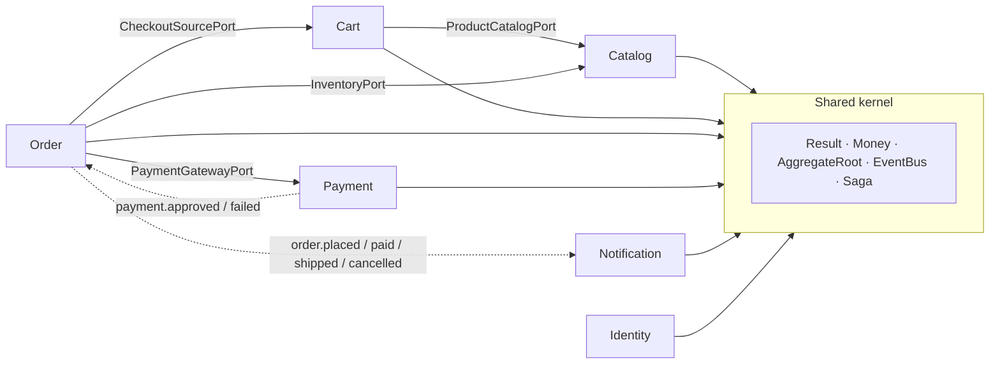
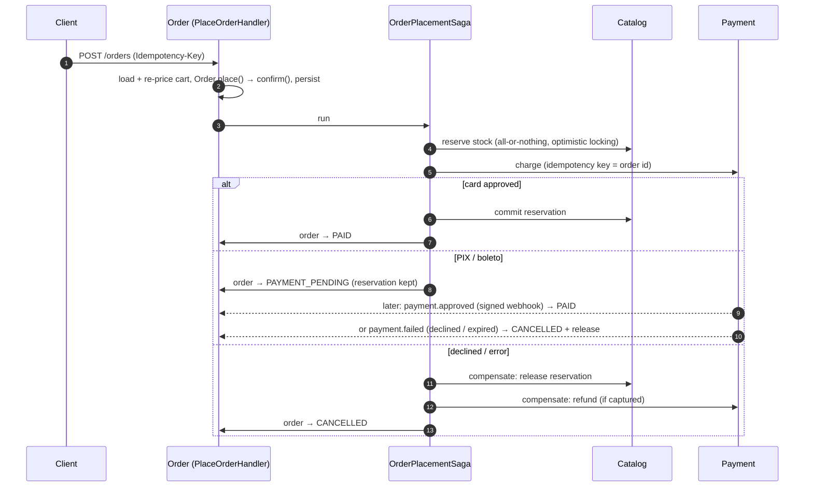
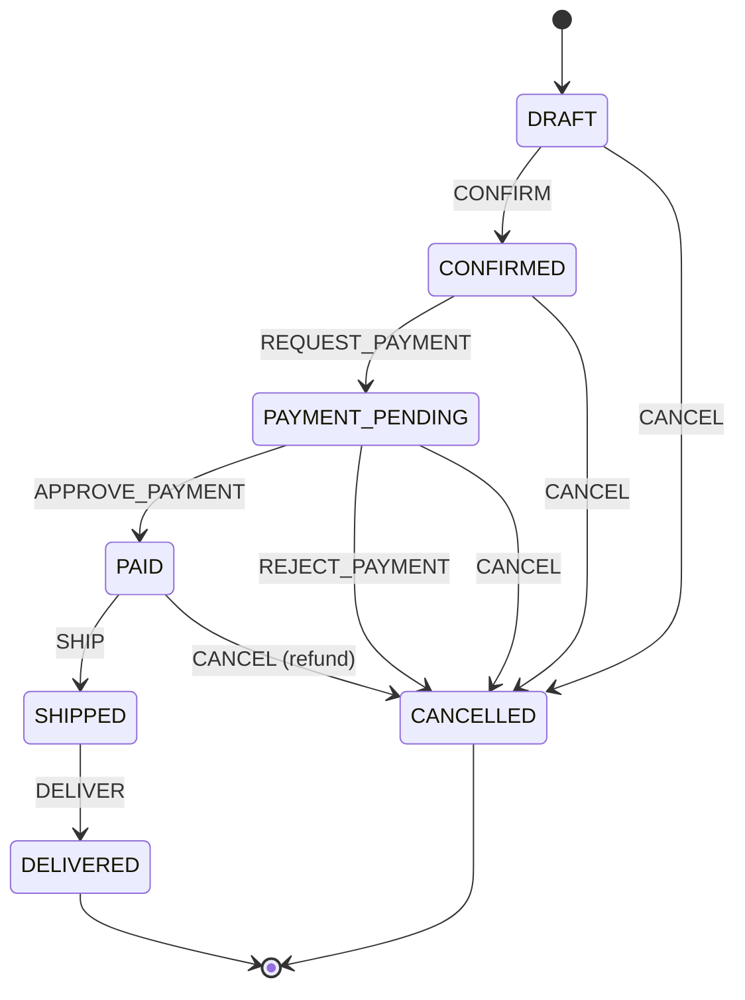

# NexusCommerce

A **modular monolith** e-commerce backend built with **NestJS 12 / TypeScript**, applying
**Domain-Driven Design** and **hexagonal architecture** (ports & adapters). It covers the
core flows of an online store: catalog, cart, checkout with an orchestrated saga,
Brazilian payment methods (credit card, PIX, boleto) and asynchronous notifications.

The goal of the project is to show how to keep a single deployable **well-partitioned**:
each bounded context owns its model, data and public API, so it can be extracted into a
service later without rewriting callers.

---

## Tech stack

| Concern | Choice |
|---|---|
| Runtime | Node.js 26 (Active LTS) — CI also runs 22 and 24 |
| Framework | NestJS 12, TypeScript 6.0 (strict) |
| Persistence | PostgreSQL 18 via Prisma 7 (Rust-free client + `pg` driver adapter) |
| Cache / carts / queues | Redis 8 (ioredis 6), BullMQ 6 (job schedulers) |
| Auth | JWT (global guard, role-based authorization) |
| Tests | Jest 30 (ts-jest), Supertest, `@nestjs/testing` |
| Quality | ESLint 10 (flat config) + typescript-eslint, Prettier |
| Delivery | Multi-stage Docker image, docker-compose, GitHub Actions |

> **Why TypeScript 6 and not 7?** TypeScript 7 (the native Go compiler) does not ship the JS compiler API yet,
> which typescript-eslint (`<6.1`), ts-jest (`<7`) and `@nestjs/cli` (`~6.0`) still depend on. The project moves
> to 7 once that toolchain supports it.
>
> **ESM-only Nest.** NestJS 12 packages are ESM-only. The app stays CommonJS and loads them through Node's native
> `require(esm)` (Node 22.12+), as the official migration guide recommends; Jest runs with `--experimental-vm-modules`
> for the same reason (see the `test` scripts). Jest only supports `require(esm)` on Node 24.9+, so running the
> test suites needs Node 24.9+; on Node 22 CI builds the app and smoke-tests the compiled output instead.

---

## Architecture

### Modules and dependencies



Solid arrows are synchronous calls through **ports owned by the consumer** and implemented
by adapters that wrap the provider's public facade. Dotted arrows are **domain events** on
the in-process `EventBus`. Rules that keep the boundaries honest:

- Modules import each other only through their `index.ts` (public API). Internals such as
  entities and repositories are never imported across modules.
- Cross-module references are plain IDs, with no foreign keys between contexts.
- Notification depends on nobody; it only subscribes to events.

### Inside a module (hexagonal)

```
modules/order/
├── domain/            # Entities, value objects, state machine, events, PORTS (interfaces)
├── application/       # Use cases (commands/queries), saga, read models (views)
├── infrastructure/    # Adapters: Prisma repository, catalog/cart/payment adapters, mappers
├── presentation/      # HTTP controller + DTO validation
├── order.module.ts    # Wiring: binds ports to adapters
└── index.ts           # Public API of the module
```

The domain layer has **no NestJS or Prisma imports**. Business failures are returned as
`Result<T, DomainError>` instead of being thrown. A single exception filter maps
`DomainError` codes to HTTP statuses (`VALIDATION`→400, `NOT_FOUND`→404,
`CONFLICT`/`INVALID_STATE`→409, `BUSINESS_RULE`→422).

### Checkout saga



### Order lifecycle



All transitions go through `OrderStateMachine` and are appended to an audit trail on the order.

---

## Highlights

- **Consistency without distributed transactions.** Stock is reserved and committed with
  optimistic concurrency (`version` column plus conditional `UPDATE`), with automatic
  retries on conflict. Multi-product reservations run in a single database transaction.
- **Idempotency end to end.** The `Idempotency-Key` header on checkout, a unique
  idempotency key per payment (enforced by a DB constraint), idempotent webhook handling,
  BullMQ job IDs and notification dedup keys.
- **Payments.**
  - Card uses a sandbox acquirer with installment rules and money allocation that never loses cents.
  - PIX generates a real BR Code (EMV payload with CRC16/CCITT-FALSE).
  - Boleto produces a FEBRABAN barcode and digitable line (mod-10/mod-11 check digits,
    due-date factor rollover).
  - CPF/CNPJ are validated.
- **Webhooks.** HMAC-SHA256 over the raw body with constant-time comparison.
- **Async work with BullMQ.** Notification delivery uses exponential backoff and separates
  permanent from transient failures. A BullMQ job scheduler expires unpaid PIX/boleto charges and
  releases their stock.
- **Caching.** Cache-aside with single-flight (stampede protection), namespace invalidation
  via `SCAN`, and graceful degradation when Redis is down. Carts live in Redis with a
  sliding TTL.
- **Security.** Secure-by-default global JWT guard (`@Public()` opt-out), role guard,
  whitelisted DTO validation, constant-time login (no user enumeration), and a
  fail-fast env validation that refuses placeholder secrets in production.

---

## Running locally

Requirements: Node.js 22.12+ to run the app, 24.9+ to run the tests (26 recommended, see `.nvmrc`) and Docker.

```bash
cp .env.example .env
docker compose up -d postgres redis
npm install                 # also generates the Prisma client
npx prisma migrate deploy
npm run start:dev           # http://localhost:3000/api/v1
```

Or run the whole stack (migrations run as a one-off container):

```bash
docker compose up --build
```

### Quick tour

```bash
# Register a customer
curl -s -X POST localhost:3000/api/v1/auth/register \
  -H 'Content-Type: application/json' \
  -d '{"email":"ana@example.com","name":"Ana","password":"Secret123"}'

# Browse the catalog (public)
curl -s 'localhost:3000/api/v1/products?q=teclado&sort=price_asc&inStock=true'

# Add to cart and check out with PIX
curl -s -X POST localhost:3000/api/v1/cart/items -H "Authorization: Bearer $TOKEN" \
  -H 'Content-Type: application/json' -d '{"productId":"<id>","quantity":1}'
curl -s -X POST localhost:3000/api/v1/orders -H "Authorization: Bearer $TOKEN" \
  -H 'Idempotency-Key: checkout-0001' -H 'Content-Type: application/json' \
  -d '{"paymentMethod":{"type":"PIX"}}'
```

Sandbox card tokens: `tok_<anything>` is approved; `tok_declined` and
`tok_insufficient_funds` are declined.

### API overview

| Method | Path | Access |
|---|---|---|
| POST | `/auth/register`, `/auth/login` | public |
| GET | `/products`, `/products/:id`, `/categories` | public |
| POST/PATCH | `/products`, `/products/:id/stock`, `/products/:id/price`, `/categories` | admin |
| GET/POST/PATCH/DELETE | `/cart`, `/cart/items[/:productId]`, `/cart/coupon` | customer |
| POST | `/orders` (checkout) · `/orders/:id/cancel` | customer |
| GET | `/orders`, `/orders/:id` | owner / admin |
| PATCH | `/orders/:id/ship`, `/orders/:id/deliver` | admin |
| GET | `/payments/:id` | owner / admin |
| POST | `/payments/webhooks/provider` | HMAC-signed |
| GET | `/health/live`, `/health/ready` | public |

---

## Testing

```bash
npm test            # unit tests: domain, use cases, saga, payments, DI wiring
npm run test:cov
npm run test:e2e    # needs PostgreSQL + Redis (docker compose up -d postgres redis)
```

- **Unit tests** use in-memory adapters that behave like the real ones: they store copies
  and enforce optimistic locking, so lost-update bugs surface in tests. One test compiles
  the entire `AppModule` with external connections stubbed, which catches DI wiring errors
  without infrastructure.
- **E2E tests** boot the real app against PostgreSQL and Redis and drive full flows over
  HTTP: card checkout through delivery, declined payment with stock release, PIX with a
  signed webhook, and authorization rules.
- In CI the quality job runs on Node 22, 24 and 26. E2E runs against PostgreSQL 18 and
  Redis 8 service containers, and the Docker image is built on every push.

---

## Architecture Decision Records

| # | Decision |
|---|---|
| [0001](docs/adr/0001-modular-monolith.md) | Modular monolith instead of microservices |
| [0002](docs/adr/0002-hexagonal-architecture.md) | Hexagonal architecture with consumer-owned ports |
| [0003](docs/adr/0003-in-process-domain-events.md) | In-process domain events (and when to add an outbox) |
| [0004](docs/adr/0004-optimistic-concurrency.md) | Optimistic concurrency for stock |
| [0005](docs/adr/0005-orchestrated-checkout-saga.md) | Orchestrated saga for checkout |
| [0006](docs/adr/0006-redis-for-carts-cache-and-queues.md) | Redis for carts, cache and queues |

## Known limitations / next steps

- Events are dispatched in-process after the DB write; a crash in between can lose an event
  (see ADR 0003). The next step is a transactional outbox.
- Payment providers are sandboxes. A real acquirer or PSP would plug in as another `PaymentStrategy`.
- Provider errors are treated as declines. Production would need an `UNKNOWN` state plus reconciliation.
- No OpenAPI document yet. `@nestjs/swagger` decorators would be the next addition.

## License

MIT
